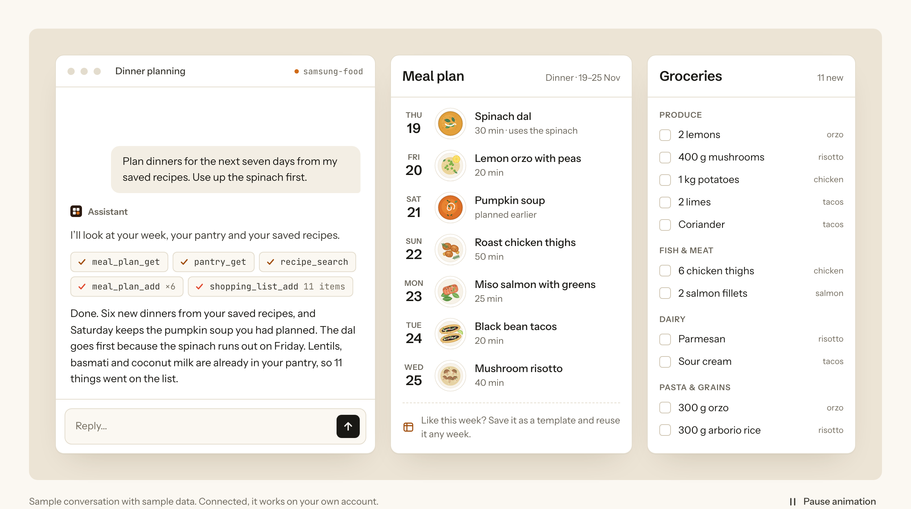
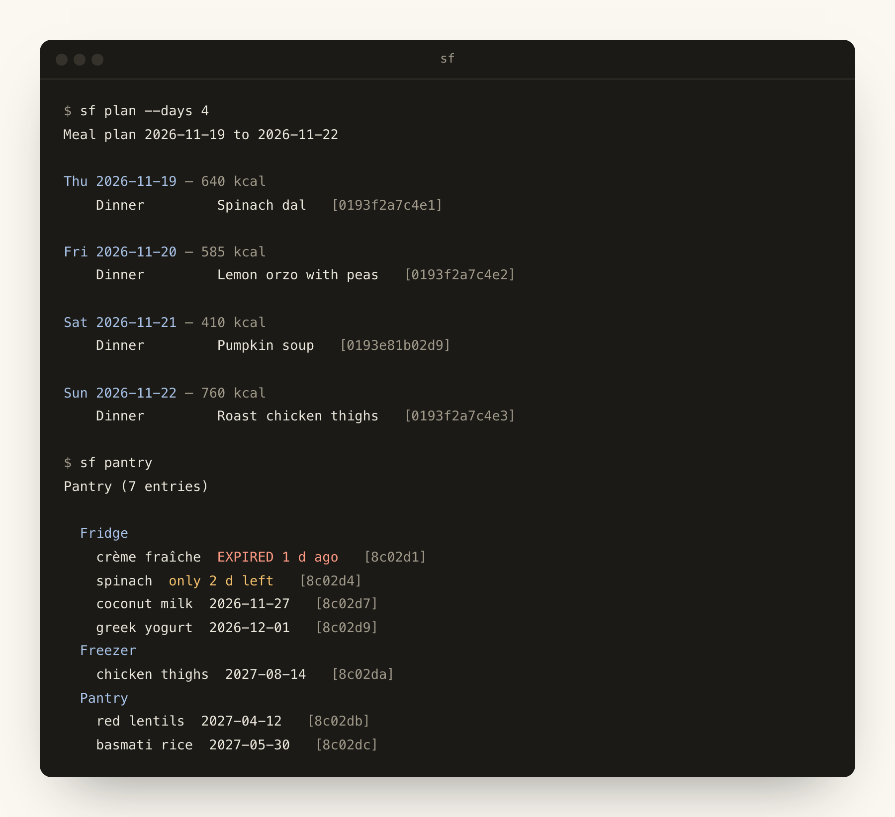

<p align="center">
  <picture>
    <source media="(prefers-color-scheme: dark)" srcset="assets/brand/logo-dark.svg">
    
  </picture>
</p>

<h1 align="center">Unofficial Samsung Food MCP</h1>

<p align="center">
  Unofficial MCP server, CLI and local HTTP API for Samsung Food: meal plan, shopping list, recipes and pantry from your AI client or terminal.
</p>

<p align="center">
  <a href="https://github.com/derdennis1012/unofficial-samsung-food-mcp/actions/workflows/ci.yml"></a>
  <a href="LICENSE"></a>
  
  <a href="https://derdennis1012.github.io/unofficial-samsung-food-mcp/">Website</a>
</p>

> **Disclaimer.** This project is unofficial. It is not affiliated with,
> endorsed by, or supported by Samsung or Whisk. "Samsung Food" is a trademark
> of its owner. It talks to a private, undocumented API that can change or
> break at any time. Using it may violate Samsung Food's Terms of Service and
> could get your account restricted. Use it at your own risk. Write tools
> modify real data in your account, including shared lists and meal plans.

<!-- Screenshots: assets/screenshots/*.png -->
<p align="center">
  
  
</p>

## What you can do

Samsung Food has no public API. This project uses the same private API as the web app and gives you
four ways to use it:

| Way | What it is |
|---|---|
| **MCP server** | 89 tools for Claude, Cursor, VS Code and any other MCP client |
| **CLI** (`sf`) | Meal plan, lists, recipes and pantry in the terminal |
| **HTTP API** | A local REST/JSON server (`sf serve`) with OpenAPI, API key and read-only mode, for scripts, Home Assistant, n8n and Shortcuts; also MCP over HTTP. See [docs/http-api.md](docs/http-api.md) |
| **Library** | The `SamsungFood` class for your own Node.js code |

Areas covered: meal plan and weekly templates, shopping lists, recipes and collections, pantry with
shelf-life lookup, food and nutrition data, account settings, and raw access to every API method.
Example prompts for an AI client: "Plan dinners for next week from my saved recipes and put the
ingredients on my shopping list", "What in my pantry expires this week?", "Import this recipe URL".

## Quick start

Requires Node.js 20 or newer and a Samsung Food account.

### 1. One command

```bash
npx unofficial-samsung-food-mcp setup
```

It logs you in (a page opens in your browser), finds Claude Code, Claude Desktop, Cursor and VS Code,
and asks which of them to configure. Then restart the client and ask: "What's on my meal plan this
week?" Preview first with `--dry-run`; undo with `--remove`.

> The npm package is not released yet. Until then: clone the repository, run `npm install`, then
> `node bin/sf.js setup --local` (the clients then start this checkout instead of `npx`).

**How the login works.** Samsung Food has no OAuth or API keys, so the tool takes over the session of
your browser once. The login page shows one button: drag it to your bookmarks bar, open
[app.samsungfood.com](https://app.samsungfood.com) and click it there. No browser on the machine
(SSH)? `sf login --paste`. The session grants full access to your account; it stays on your computer.

### 2. Hosted connector

For ChatGPT or claude.ai without running anything locally: the [hosted connector](docs/hosted.md)
(closed beta).

### 3. Manual configuration

```json
{
  "mcpServers": {
    "samsung-food": { "command": "npx", "args": ["-y", "unofficial-samsung-food-mcp"] }
  }
}
```

Paths and formats for every client (Claude Desktop, Claude Code, Cursor, VS Code, generic stdio) are
in [docs/mcp-clients.md](docs/mcp-clients.md). Log in first with `sf login`.

### From source

```bash
git clone https://github.com/derdennis1012/unofficial-samsung-food-mcp.git
cd unofficial-samsung-food-mcp
npm install
npm link        # optional: provides `sf` and `unofficial-samsung-food-mcp`
```

Without `npm link`, use `node bin/sf.js` in place of `sf`. Development workflow:
[CONTRIBUTING.md](CONTRIBUTING.md).

## Documentation

| Page | Contents |
|---|---|
| [Getting started](docs/getting-started.md) | One-command setup, login walkthrough, first commands |
| [MCP clients](docs/mcp-clients.md) | Setup for each client |
| [CLI reference](docs/cli.md) | Every `sf` command |
| [Tool reference](docs/tools.md) | All 89 MCP tools with parameters and examples |
| [Configuration](docs/configuration.md) | Environment variables and stored files |
| [Troubleshooting](docs/troubleshooting.md) | Expired login, schema drift, rate limits, Windows |
| [FAQ](docs/faq.md) | Terms of service, data, privacy |
| [Architecture](docs/architecture.md) | Codec, transport, schema build |
| [Samsung Food API](docs/api.md) | Protocol reference |
| [HTTP API](docs/http-api.md) | Local REST server, OpenAPI, MCP over HTTP |
| [Roadmap](ROADMAP.md) | Candidate work, good places to contribute |
| [Website](https://derdennis1012.github.io/unofficial-samsung-food-mcp/) | Project page |

## Tools at a glance

Every tool is annotated as read-only, write or destructive, validates its input strictly, and
returns text plus structured content. Of the 89 tools, 41 are read-only, 32 write and 16 destructive.

| Area | Examples |
|---|---|
| Meal plan | `meal_plan_get`, `meal_plan_add`, `meal_plan_move`, `meal_plan_clear` |
| Weekly templates | `meal_plan_save_template`, `meal_plan_apply_template` |
| Shopping lists | `shopping_list_get`, `shopping_list_add`, `shopping_list_add_recipe` |
| Recipes | `recipe_search`, `recipe_discover`, `recipe_import_url`, `recipe_create` |
| Collections | `collections_list`, `collection_add_recipes` |
| Pantry | `pantry_get`, `pantry_add`, `pantry_consume` |
| Food and nutrition | `food_storage_info`, `food_search`, `nutrition_analyze` |
| Account and login | `account_info`, `auth_status`, `auth_login` |
| Raw access | `api_methods`, `api_describe`, `api_call` |

The complete list is in the [tool reference](docs/tools.md).

## Limitations

- **No global recipe search.** `recipe_search` and `sf search` only search your own saved recipes.
  The API has no catalog search by term. Use `recipe_discover`, `recipe_similar` and
  `recipe_import_url` to find new recipes.
- **Meals cannot be scaled.** A meal stores only the recipe reference. Scaling happens when
  transferring to the shopping list (`shopping_list_add_recipe` with `servings`).
- **Pantry needs a location for some items.** For ingredients that can go in the fridge or the
  freezer, Samsung Food sets no expiry date. Pass `location` to `pantry_add`, and the date is
  computed from the food graph. Without a location the tool warns and does not guess.
- **Not every website can be imported.** `recipe_import_url` fails with
  `ERROR_RECIPE_SCRAPED_NOTHING` for sites with bot protection.
- **Some areas have no dedicated tools:** community and posts, public profiles, payments and
  rewards, cart and retailer checkout, account changes (e-mail, password, phone, delete account),
  and sending links to others. Most are reachable through `api_call`, which refuses login and
  account-credential methods and redacts secrets in results, but otherwise has no safety net.
- **The API can change without notice.** If calls start failing, run `sf schema update`.
- **Logins last 14 days** and renew automatically while you use the tool; after a longer break log
  in again.

## How it works, and what it does not ship

The web app speaks gRPC-Web. This project encodes and decodes those calls with a schema-driven
protobuf codec, so it needs neither `protoc` nor `.proto` files. **The Samsung protocol schema, the
web app's bundles and the food graph are not distributed with this repository.** On first use they
are fetched from Samsung's public web app and CDN onto your own machine and cached in
`~/.samsung-food` (or `$SAMSUNG_FOOD_HOME`). The bundles are read as plain text and never executed.
What the source code does contain is the factual interface data needed to talk to the API: RPC
method names, some enum values, field masks and category names as the web app uses them, plus a
small hand-made schema fixture for the offline tests. No telemetry. Details:
[Architecture](docs/architecture.md) and [FAQ](docs/faq.md).

## Contributing, security, license

- Contributions are welcome: [CONTRIBUTING.md](CONTRIBUTING.md), [ROADMAP.md](ROADMAP.md)
- Report vulnerabilities privately: [SECURITY.md](SECURITY.md). Never attach tokens, cookies or HAR files to issues.
- Changes: [CHANGELOG.md](CHANGELOG.md). Conduct: [CODE_OF_CONDUCT.md](CODE_OF_CONDUCT.md)
- License: MIT, see [LICENSE](LICENSE). It covers the code in this repository only and grants no
  rights to Samsung Food, its API, data or trademarks.
