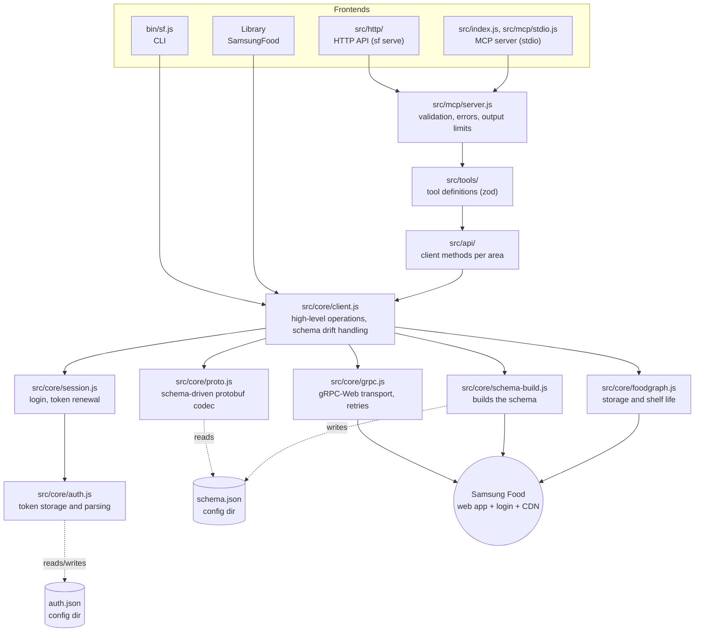

# Architecture

Samsung Food has no public API. Its web app talks gRPC-Web to `app.samsungfood.com/api/grpc-web/`.
This project speaks the same protocol with a schema-driven protobuf codec, so it needs neither
`protoc` nor `.proto` files. The protocol itself is documented in [api.md](api.md).

## Overview



## Modules

| File | Responsibility |
|---|---|
| `src/core/schema-build.js` | Builds the protocol schema from the web app's public JavaScript bundles. |
| `src/core/proto.js` | Schema-driven protobuf encoder and decoder. Rejects misspelled field names instead of dropping them. |
| `src/core/grpc.js` | gRPC-Web transport: framing, trailers, status codes, timeouts, retries. |
| `src/core/client.js` | High-level operations (`SamsungFood` class), schema drift handling. |
| `src/api/` | Client methods per area (lists, meal plan, recipes, food), installed onto the class. |
| `src/core/auth.js` | Token storage (`auth.json`) and parsing of pasted credentials. |
| `src/core/session.js` | Login validation, token renewal. |
| `src/core/foodgraph.js` | Storage location and shelf-life logic, food graph download. |
| `src/tools/` | MCP tool definitions per area (zod schemas, annotations, examples). |
| `src/mcp/server.js` | Tool listing and call wrapper: validation, error messages, output limits. |
| `src/index.js`, `src/mcp/stdio.js` | MCP server entry point (stdio); `index.js` is the thin bin entry, `mcp/stdio.js` the implementation. |
| `src/lib.js` | Public package export (`SamsungFood` and helpers). |
| `bin/sf.js` | CLI. |
| `test/` | Offline tests (`npm test`), opt-in live suite in `test/live/`, `validate-har.js`. |

## The schema build

Samsung Food ships generated gRPC-Web clients in its public JavaScript bundles. They embed compact
message descriptors and RPC descriptors as plain data. `schema-build.js`:

1. downloads the web app page and finds its `main-*.js` bundles on `cdn.whisk.com`;
2. scans the bundles **as text**; they are never executed;
3. resolves the descriptors into a flat schema (RPC name to request and response fields, plus
   message definitions);
4. writes `schema.json` into the config directory.

**The schema, the bundles and the food graph are not distributed with this package.** The schema is
built on your machine on first use and refreshed after 7 days (in the background for the
long-running MCP server; a stale copy is used if the refresh fails). `sf schema update` rebuilds it
on demand. The food graph is downloaded on first use and refreshed after 30 days.

What the repository does contain is factual interface data the client needs to talk to the API,
taken from how the web app uses it: RPC method names (in `src/core/client.js` and `src/api/`), some enum
values (meal times, storage locations, sort and category types), field masks (`MASK` in `src/core/client.js`)
and category names. `test/fixtures/schema.json` is a small hand-made schema (RPC method names and a
few field names with arbitrary field numbers) so the offline tests run without network.

## Codec

`proto.js` encodes and decodes protobuf using the schema, so there are no generated classes. It
covers what the app uses. Unknown field names raise an error. `test/validate-har.js` checks the
codec against real traffic: it decodes every request in a HAR capture from your own browser,
re-encodes it, and compares byte for byte. Never commit a HAR file, it contains your token.

## Transport

`grpc.js` sends unary calls as `application/grpc-web+proto` with the headers the web app uses.
gRPC-Web returns HTTP 200 even for errors; the status is in the trailer frame, which is parsed.

Reliability rules:

- Each attempt has a timeout (`SAMSUNG_FOOD_TIMEOUT_MS`).
- Network errors, HTTP 429/5xx and gRPC `UNAVAILABLE`, `DEADLINE_EXCEEDED`, `RESOURCE_EXHAUSTED`,
  `ABORTED` are retried up to `SAMSUNG_FOOD_RETRIES` times with exponential backoff and jitter,
  honouring `Retry-After`.
- Read-only methods are always retried. A method counts as read-only by name (`Get*`, `Search*`,
  and similar) unless the caller says otherwise.
- Write methods are only retried when the request provably never left the machine (connection
  refused, DNS failure) or the server rate-limited it. A write with an unknown outcome is reported
  as such and not repeated, so retries cannot duplicate writes.

## Schema drift

If a call fails in a way that suggests the API changed (unknown method, undecodable response,
invalid-argument errors naming fields), the client rebuilds the schema once and repeats the call.
This happens only when it cannot apply a write twice: for reads, or when the server rejected the
request as invalid.

## Authentication and sessions

`auth.js` stores the session token in `auth.json` (mode 600, written atomically through a temp
file and rename). `session.js` validates a pasted credential with `GetMe`, then renews the token
through `AuthAPI/IssueAuthCode` and `UseAuthCode` on `login.whisk.com`. Before each API call, a
token with unknown expiry or less than 7 days left is renewed first. Concurrent calls share one
renewal. See [api.md](api.md#authentication) for the protocol.

## The HTTP API

`src/http/` serves the same tool registry over HTTP (`sf serve`, or `sf-api`):
`server.js` routes and maps errors to HTTP statuses, `apikey.js` manages the API key,
`openapi.js` builds the OpenAPI document and the `/docs` page from the tool definitions, and
`mcp.js` serves MCP over Streamable HTTP (stateless, one server per request) with the same tool
selection. Tools run through the same handlers as in the MCP server, so validation and behaviour
are identical. See [http-api.md](http-api.md).

## The MCP layer

`src/tools/*.js` define tools with `defineTool`: a name, a description, a kind (`read`, `write`,
`update`, `destructive`) that determines the MCP annotations, a strict zod input schema, a valid
example, and a handler that calls a client method. `src/tools/schema.js` turns the zod schema into
the JSON Schema (draft 2020-12, input side: fields with a default are optional) that MCP
`tools/list`, `GET /v1/tools` and the OpenAPI document publish. `src/mcp/server.js` validates arguments, calls the
handler, and turns every outcome into an MCP result:

- success: JSON text plus `structuredContent`; text over 40000 characters is truncated with a hint;
- failure: an `isError` result with an actionable message, never a stack trace.

Stray exceptions are logged to stderr and cannot crash the stdio server. stdout carries only the
protocol. The client (and with it the schema) is created lazily on the first tool call that needs
it. `auth_status` does not need it.

[tools.md](tools.md) is generated from these definitions by `scripts/gen-tools-doc.js`.

## Library use

```js
import { SamsungFood } from './src/core/client.js';

const sf = await SamsungFood.create();   // builds the schema on first use
const plan = await sf.schedule({ from: '2026-09-21', days: 7 });   // read-only
const pantry = await sf.pantry({ includeConsumed: false });        // read-only

// raw access to any RPC method
const items = await sf.call('whisk.x.foodlist.v1.FoodlistAPI/GetItems', {
  mask: { paths: ['name', 'expiry_date'] },
  filters: { presence: [1] },
});
```

Writes (`sf.addMeal(...)`, `sf.addRecipeToList(...)`) change your real account. There is no stable
library API before 1.0; method names can change.
