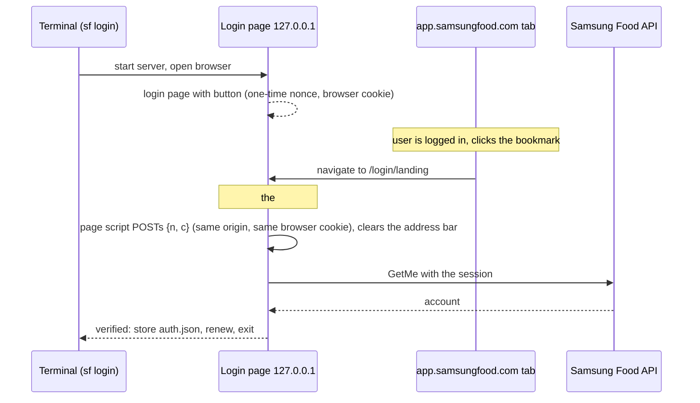

# Getting started

This page takes you from nothing to a connected AI client and your first commands.
For the MCP client setup see [MCP clients](mcp-clients.md).

> **Unofficial.** This project is not affiliated with Samsung or Whisk. It uses a private,
> undocumented API and may violate the Samsung Food Terms of Service. Read the
> [FAQ](faq.md) before using it on an account you care about.

## Requirements

- Node.js 20 or newer
- A Samsung Food account (any login method)
- A desktop browser, for the one-time login

## Set up in one command

```bash
npx unofficial-samsung-food-mcp setup
```

1. It checks Node and whether you are logged in. If not, a login page opens in your browser
   (details below) and the terminal shows `Connected as <your name>`.
2. It lists the MCP clients it finds (Claude Code, Claude Desktop, Cursor, VS Code) and asks which to
   configure; Enter takes all. Config files are backed up first, and only the `samsung-food` entry
   is touched.
3. Restart the client and ask: "What's on my meal plan this week?"

`--dry-run` shows what would happen without writing anything, `--yes` skips the question (scripts),
`--remove` takes the entries out again.

> Working from a clone (see [From source](#from-source))? Run `node bin/sf.js setup --local`: the
> clients then start your checkout with the current `node` instead of `npx`.

**Other ways in.** No local install: the [hosted connector](hosted.md) for ChatGPT and claude.ai
(closed beta). Configuring a client by hand: [MCP clients](mcp-clients.md) (log in first with
`sf login`).

## Log in

Samsung Food has no OAuth and no API keys, and it signs users in on a separate domain with a
captcha and social logins, so this tool cannot log in by itself. It takes over the session of your
browser instead. That works with every
login method (Google, Apple, e-mail, ...).

### What you are copying

The web app keeps a session token in the cookie `whisk.USER_TOKEN`. The token is a bearer token:
anyone who has it can read and change **everything** in your Samsung Food account until it expires
(14 days, see below). Treat it like a password. Do not paste it into issues, chats you do not
control, or shared documents.

### Steps

Run:

```bash
sf login
```

`sf login` starts a small page on your own computer (`http://127.0.0.1:<random port>`, only for
this login, closed afterwards) and opens it in your browser. The page shows one button:

1. Drag the button **Send to sf login** to your bookmarks bar.
2. Open <https://app.samsungfood.com> in the same browser and log in.
3. Click the bookmark there. The page checks the session with Samsung Food, shows
   "Connected as <your name>", and the terminal prints `Logged in as ...` and exits.

The button is made for this one login (it carries a one-time code that expires after 10 minutes),
so after a later `sf login` drag the new one. It only reads the `whisk.USER_TOKEN` cookie, not the
other cookies of the site. If you click it on another site it says so and offers to open Samsung
Food.

How the session gets from Samsung Food to the CLI:



**Other ways.** The page also has a paste field ("Other ways: paste the session"): run
`copy(document.cookie)` in the DevTools console on app.samsungfood.com and paste it. Without a
browser on the machine (SSH, containers) use the terminal:

```bash
sf login --paste      # paste, then Ctrl-D (Ctrl-Z, Enter on Windows)
```

`sf login` takes its input in this order: arguments on the command line, standard input (with
`--paste`, or when input is piped), the clipboard (only if its content looks like a Samsung Food
credential), and finally, in an interactive terminal, the browser page. `--no-browser` prints the
page URL instead of opening it. Passing the credential as an argument works but prints a warning:
it ends up in your shell history. Accepted input everywhere:

- the full cookie string (the token is the `whisk.USER_TOKEN` cookie)
- the bare token
- `Bearer <token>`
- an `Authorization` header line
- a "Copy as cURL" command from the DevTools network tab

Clipboard access needs `pbpaste` (macOS), PowerShell `Get-Clipboard` (Windows), or one of
`wl-paste`, `xclip`, `xsel` (Linux).

`sf setup` (or `npx unofficial-samsung-food-mcp setup`) runs this same login when you are not
logged in yet.

### What login does

1. Validates the token by calling `GetMe` and prints the account name.
2. Renews the token once to learn its expiry.
3. Stores it in `auth.json` inside the config directory (`~/.samsung-food`, or
   `$SAMSUNG_FOOD_HOME`), with file mode 600, written atomically.

If you log in with a different account than before, the cached meal plan ID from the old account is
dropped.

### Token lifetime

Tokens last 14 days and renew automatically. Before an API call, if the expiry is unknown or less
than 7 days away, the tool exchanges the current token for a new one. As long as you use the CLI
or MCP server at least about every two weeks, you do not need to log in again. After a longer
break run `sf login` again; tools then answer with "Samsung Food login missing or expired. Run
`sf login` ..." instead of a raw API error. Every renewal creates a new session on your account.

```bash
sf status      # token present, expiry, days left, last renewal, schema state
sf renew       # renew now (normally automatic)
sf logout      # remove the stored session completely
```

Instead of `auth.json` you can provide the token through the environment variable
`SAMSUNG_FOOD_TOKEN`. It overrides the file and is never written to disk, and it is not renewed
automatically.

## First commands

The protocol schema is built the first time it is needed (a few seconds, one-time, see
[Architecture](architecture.md)).

```bash
sf whoami                 # check the account
sf plan --days 7          # meal plan for the next week
sf list                   # shopping list
sf pantry                 # pantry by storage location
sf search "pumpkin soup"  # your own saved recipes
sf discover --limit 10    # suggestions from the catalog
```

Commands that change data:

```bash
sf list add "2 onions" "500 g flour"
sf plan add <recipeId> --date 2026-09-22 --meal dinner
```

These change your real account, including shared lists and meal plans. Commands that delete or
overwrite data (`sf plan rm`, `sf plan clear`, `sf list rm`, `sf pantry rm`, `sf plan template rm`,
`sf plan template apply --replace`) ask for confirmation, or need `--yes` when not run in a terminal.

Commands that show data print formatted text; add `--json` for the raw JSON. Most write commands
print their JSON result. The full list is in the [CLI reference](cli.md).

## Next steps

- Connect an AI client: [MCP clients](mcp-clients.md)
- All commands: [CLI reference](cli.md)
- All settings: [Configuration](configuration.md)
- Something failed: [Troubleshooting](troubleshooting.md)

## From source

```bash
git clone https://github.com/derdennis1012/unofficial-samsung-food-mcp.git
cd unofficial-samsung-food-mcp
npm install
npm link          # optional: puts `sf` and `unofficial-samsung-food-mcp` on your PATH
node bin/sf.js setup --local
```

Without `npm link`, replace `sf` in all examples with `node bin/sf.js`, and start the MCP server
with `node src/index.js`. `sf help` runs without login and network. Working on the code:
[CONTRIBUTING.md](../CONTRIBUTING.md).
