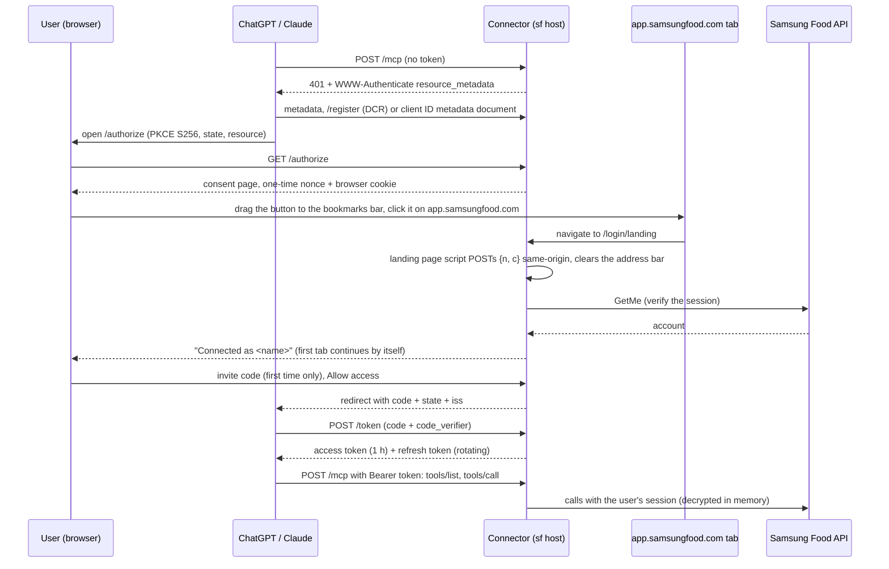

# Hosted connector (`sf host`)

`sf host` runs this project as a **remote MCP server for many users**, so people can add their
Samsung Food account to ChatGPT, claude.ai (web, desktop, mobile), Claude Code and other clients
that support remote MCP servers with OAuth. Nobody has to install anything locally.

It is an OAuth 2.1 authorization server plus a protected Streamable HTTP MCP endpoint, built on
`node:http` and `node:sqlite`, in the same repository and with the same tools as the local server.
Anyone can run their own instance. QAD Soft runs one as a closed beta at
`https://food-mcp.qadsoft.dev` (invite codes).

Contents: [How it works](#how-it-works) · [Add it to ChatGPT or Claude](#add-it-to-chatgpt-or-claude) ·
[Self-hosting](#self-hosting) · [Configuration](#configuration) · [Admin CLI](#admin-cli) ·
[Threat model](#threat-model) · [Protocol details](#protocol-details) · [Limits and known gaps](#limits-and-known-gaps)

## How it works

Samsung Food has no OAuth and no way to grant limited access. The connector therefore needs the
user's Samsung Food **session** (the `whisk.USER_TOKEN` cookie of app.samsungfood.com), like the
local `sf login`. The handover is the same in both: a one-click bookmark button, with a paste field
as fallback.



What the user sees on the consent page:

1. Which app asks and where they will be sent back. For a client ID metadata document the name is
   shown with the host it was fetched from (`ChatGPT (chatgpt.com)`), the only part that is
   verified; a dynamically registered name is marked `(unverified)`. The redirect host is shown
   prominently; loopback redirects (Claude Code) get an extra hint. Control and format characters
   (bidi overrides, zero-width) are removed from names.
2. A plain statement of what they hand over and that it is stored encrypted.
3. Step "Easiest: one button": drag **Send to connector** to the bookmarks bar, open
   app.samsungfood.com in the same browser, click the bookmark. The bookmarklet checks that it runs on
   `app.samsungfood.com` (otherwise it says so and offers to open it), takes only the
   `whisk.USER_TOKEN` cookie and navigates to the connector with the nonce and the cookie in the
   URL **fragment**. Fragments are never sent in HTTP requests, so the session does not appear in
   server or proxy logs; the landing page posts it and removes it from the address bar.
4. Fallback "Other ways: paste the session": the result of `copy(document.cookie)`, a bare token,
   `Bearer <token>` or a cURL command.
5. "Connected as <name>", the invite code field (only for accounts that are not registered yet), a
   **Read only** checkbox, then **Allow access** or **Cancel**.

The nonce is single use, expires after 10 minutes, allows 5 attempts and is bound to the browser
that opened the page (an HttpOnly cookie whose hash is stored with the pending login). A session
handed over from another browser, from another site (Origin check, JSON-only bodies) or after the
expiry is refused. That prevents login CSRF and session fixation: nobody can make your browser
complete their pending login or the other way round.

When the Samsung session stops working (logout on all devices, password change, more than 14 days
without use), the next tool call returns a clear message with the reconnect link
(`/reconnect`), ChatGPT additionally gets `_meta["mcp/www_authenticate"]` to show its re-link UI,
and the following MCP requests answer `401`, so the client starts a new sign-in. Users who connect
again need no new invite.

**Disconnect.** Removing the connector in ChatGPT or Claude stops the app from using it. To delete
the stored data as well:

- ask the assistant to call `connector_disconnect` (this connection; `everything: true` for all
  connections and the registration), or
- open `/disconnect` on the connector, hand over the session once more and confirm, or
- the client revokes its refresh token (`/revoke`), which deletes that connection.

Inactive connections are deleted after 30 days (configurable). Registrations that never led to a
connection are deleted after 24 hours, registrations without connections after 7 idle days.

## Add it to ChatGPT or Claude

Use the MCP URL of the instance, for the QAD Soft beta `https://food-mcp.qadsoft.dev/mcp`.

**Claude** (claude.ai, Desktop, mobile; Free plans allow one custom connector), per
[Add a connector that isn't in the directory](https://claude.com/docs/connectors/custom/add-unlisted):

1. **Customize > Connectors**, **Add**, **Add custom connector**.
2. Name `Samsung Food`, the MCP URL, **Continue**.
3. Keep the detected settings (authentication **Sign in now**, OAuth client "Use Claude's published
   identity" or "Register automatically"; both work), **Add**, then **Connect**.
4. Follow the consent page. In a chat, turn the connector on under **+ > Connectors**.

On Team and Enterprise plans an Owner adds it under **Organization settings > Connectors**
(**Add**, **Custom**, **Web**), and members connect under **Customize > Connectors**.

Claude Code: `claude mcp add --transport http samsung-food https://food-mcp.qadsoft.dev/mcp`, then
`/mcp` to sign in (uses its client ID metadata document and a loopback redirect).

**ChatGPT** (web), per [Connect to ChatGPT](https://developers.openai.com/apps-sdk/deploy/connect-chatgpt)
and [developer mode](https://developers.openai.com/api/docs/guides/developer-mode). Workspace
policies decide whether custom MCP servers are allowed:

1. Open **Plugins** (`chatgpt.com/plugins`), the plus button, **Add custom MCP server**.
2. Name and description, under **Connection** the MCP URL (including `/mcp`).
3. Authentication **OAuth** (ChatGPT uses its client ID metadata document or DCR), confirm the risk
   warning with **I understand and want to continue**, **Create as a plugin**.
4. Install it, start a new conversation, type `@` and pick it. Write actions ask for confirmation
   (every tool without `readOnlyHint: true`).

The menu labels of both products change often; the linked pages are the reference.

## Self-hosting

Requirements: Docker (or Node.js 22.13+, 24 recommended), a domain with HTTPS through a reverse
proxy, and a persistent volume.

```bash
docker build -t samsung-food-connector .
docker run --rm samsung-food-connector keygen          # prints a master key
cp docker-compose.example.yml docker-compose.yml
cat > connector.env <<'EOF'
SF_HOST_PUBLIC_URL=https://food-mcp.example.com
SF_HOST_MASTER_KEY=<output of keygen>
SF_HOST_OPERATOR=Example Ltd
SF_HOST_PRIVACY_URL=https://example.com/privacy
SF_HOST_TERMS_URL=https://example.com/terms
SF_HOST_IMPRINT_URL=https://example.com/imprint
EOF
chmod 600 connector.env
docker compose up -d
docker compose exec connector node src/hosted/main.js invites create --uses 1 --note "for Anna"
```

The image runs as user `node`, with the root file system read-only in the compose example, all
capabilities dropped and `/data` as the only writable volume (database and the protocol schema
cache). It has a health check on `/healthz`. Back up the volume **and** keep the master key: without
it the database is useless (by design).

The compose example publishes **no port**: the reverse proxy reaches the container over a shared
Docker network (`docker network create proxy`, and the proxy container joins it). Do not publish
the port on `0.0.0.0` (`"8788:8788"`) on a host with a public IP: Docker's port publishing bypasses
host firewalls such as ufw, and anyone could then talk to the connector directly. If the proxy runs
on the host itself, use the commented `127.0.0.1:8788:8788` variant.

Reverse proxy, for example Caddy (in the same Docker network):

```
food-mcp.example.com {
    reverse_proxy connector:8788
}
```

Set `SF_HOST_TRUST_PROXY=1` when exactly one proxy adds `X-Forwarded-For` (only used for rate
limits), and **only when nothing but that proxy can reach the port**. Otherwise every client can
forge the header and get fresh rate-limit buckets per request. The public URL comes from `SF_HOST_PUBLIC_URL`, never from request headers. Make sure the
proxy does not log query strings of `/authorize` if you care about `state` values; tokens never
appear in URLs.

Without Docker: `SF_HOST_PUBLIC_URL=... SF_HOST_MASTER_KEY=... sf host` (or `sf-host`, `npm run host`).
For a local test, `SF_HOST_PUBLIC_URL=http://localhost:8788` is allowed (http only on loopback).

## Configuration

| Variable | Meaning | Default |
|---|---|---|
| `SF_HOST_PUBLIC_URL` | **Required.** Public origin, no path (`https://food-mcp.example.com`). Issuer and resource (`<url>/mcp`) derive from it. | - |
| `SF_HOST_MASTER_KEY` / `SF_HOST_MASTER_KEY_FILE` | **Required.** 32 random bytes, base64/base64url/hex (`sf host keygen`). The file variant suits Docker secrets. | - |
| `SF_HOST_DATA_DIR` | Database directory | `./data` (`/data` in Docker) |
| `SF_HOST_BIND`, `SF_HOST_PORT` | Listen address and port | `127.0.0.1`, `8788` (`0.0.0.0` in Docker) |
| `SF_HOST_TRUST_PROXY` | Number of trusted proxies for `X-Forwarded-For` | `0` |
| `SF_HOST_NAME`, `SF_HOST_OPERATOR` | Display name, operator shown in the page footer | `Samsung Food connector`, empty |
| `SF_HOST_INVITE_REQUIRED` | Closed beta: new accounts need an invite code | `true` |
| `SF_HOST_READ_ONLY` | Offer only read tools to everyone | `false` |
| `SF_HOST_ACCESS_TTL` | Access token lifetime in seconds | `3600` |
| `SF_HOST_REFRESH_TTL_DAYS` | Refresh token lifetime (renewed on every rotation) | `30` |
| `SF_HOST_INACTIVITY_DAYS` | Delete connections and registrations unused for this long | `30` |
| `SF_HOST_RATE_PER_MIN` | Tool calls per user and minute | `60` |
| `SF_HOST_UPSTREAM_CONCURRENCY` | Concurrent requests to Samsung Food, all users together (at most 2 per user; 8 times this many may wait, beyond that calls are refused as busy) | `8` |
| `SF_HOST_MAX_CLIENTS` | Cap on dynamically registered clients; when full, the oldest registration that never led to a connection is dropped | `10000` |
| `SF_HOST_REDIRECT_HOSTS` | Exact https redirect host allowlist, for dynamic registration **and** client ID metadata documents. Loopback (`localhost`, `127.0.0.1`, `[::1]`, any port; Claude Code and other native clients) is always allowed. Empty = loopback only. `*` = any https host: **unsafe**, any website can then register under a name like "ChatGPT", show your consent page and receive the code | `chatgpt.com,claude.ai,claude.com` |
| `SF_HOST_CIMD_HOSTS` | Hosts whose client ID metadata documents are fetched (ChatGPT: `https://chatgpt.com/oauth/.../client.json`, Claude Code: `https://claude.ai/oauth/claude-code-client-metadata`); `*` = any public host (the redirect allowlist still applies), empty disables CIMD | `chatgpt.com,claude.ai,claude.com` |
| `SF_HOST_PRIVACY_URL` / `_FILE`, `SF_HOST_TERMS_URL` / `_FILE`, `SF_HOST_IMPRINT_URL` / `_FILE` | `/privacy`, `/terms`, `/imprint`: redirect to a URL, or serve a file (`.html` as HTML, anything else as plain text). Without a value the pages say they are not set up yet. | unset |
| `SAMSUNG_FOOD_LOCALE`, `SAMSUNG_FOOD_TIMEOUT_MS`, `SAMSUNG_FOOD_RETRIES`, `SAMSUNG_FOOD_HOME` | As for the local server ([Configuration](configuration.md)); `SAMSUNG_FOOD_HOME` holds the protocol schema cache | |

## Admin CLI

Same environment as the server (`SF_HOST_DATA_DIR`, `SF_HOST_MASTER_KEY`). In Docker:
`docker compose exec connector node src/hosted/main.js <command>`.

```
sf host keygen                                  new master key
sf host invites create [--uses 1] [--days 30] [--note text] [--json]
sf host invites list [--json]                   id, uses/max, expiry, revoked, note (never the code)
sf host invites revoke <id>
sf host users list [--json]                     pseudonymous id, created, last seen, connections
sf host users delete <uid>                      user with all connections and sessions
sf host cleanup                                 run the housekeeping now (also runs hourly)
```

Invite codes look like `SF-K7QM-3PXA-9TRC` (60 bits, case and dashes do not matter) and are shown
once; only an HMAC is stored. An invite is used up when an account registers with it; existing
users reconnect without one.

## Threat model

**What is stored** (SQLite, `secure_delete` on; database, `-wal` and `-shm` files mode 600, the
process runs with umask 077 and the Docker volume is mode 700): registered OAuth clients (name, redirect
URIs, secret verifier), invite HMACs and counters, users as pseudonymous ids (HMAC of the Samsung
account id) with timestamps, connections (client, scope, read-only flag, timestamps and the
**encrypted** Samsung session), and verifiers plus wrapped keys of issued codes and tokens. No
names, e-mail addresses, IP addresses, tool arguments or results. The log has method, path, status
and duration only.

**Encryption.** Each connection has a random 256-bit key K. The Samsung session is encrypted with K
(AES-256-GCM, bound to the connection id). K is not stored: for every live code, access token and
refresh token, the database holds K wrapped with a key derived (HKDF-SHA256) from that credential's
32-byte secret, which only the client has, with the server master key as salt. Credentials are
looked up by id and checked against an HMAC verifier in constant time.

Wraps do not outlive their credential: a used code or refresh token loses its wrap at once, an
expired credential when it is presented or within a minute (the rows go with the hourly sweep).
Every refresh **rotates K**: the session is re-sealed under a new key, the old access tokens are
deleted and every remaining wrap of the old key is dropped. So a credential (or a copy of the
database) from before the last refresh no longer opens the current session.

| Attacker has | Samsung sessions |
|---|---|
| A copy of the database | Not readable (needs a credential secret and the master key) |
| Database + master key | Not readable (still needs the secret of a credential whose wrap is in that copy) |
| A stolen access token | Usable through the connector until it expires (1 h), is revoked or the client refreshes; the session itself is not revealed |
| A stolen refresh token | Usable once; when the real client refreshes too, the reuse is detected and the connection revoked |
| Database + master key + the secret of any not-yet-deleted credential of a connection | Readable for that one connection, in the state of that database copy |
| Control of the running server | Everything that passes through it: the server must decrypt the session in memory for every call. This is inherent: whoever operates the connector can act on the connected accounts. Users must trust the operator. |

"Not-yet-deleted" is meant literally: a credential is useful to an attacker as long as its wrap
exists *somewhere*. `secure_delete` overwrites freed pages in the database file, but until the next
checkpoint the old pages can still sit in the `-wal` file, and backups, snapshots or copies of the
volume keep whatever they contained at the time: a backup, the master key and a credential that
was live when the backup was taken together open that connection's session as it was then.
Encrypt backups, keep them short-lived and store the master key separately.

Other measures: PKCE S256 required, exact redirect URI match (loopback with any port, RFC 8252),
single-use codes (5 minutes, a replay revokes the connection), refresh token rotation, audience
binding (tokens only for `<public url>/mcp`), RFC 9207 `iss` in every authorization response,
strict CSP with per-response nonces, `frame-ancestors 'none'`, HSTS, no-store caching, input size
limits, rate limits per client network (logins, consent and disconnect pages, invites,
registration, tokens, tool calls; IPv6 counted per /64; a full limiter evicts the oldest windows
and never resets everybody), at most 5 pending logins per network (a full pool drops the oldest
login nobody has handed a session to yet), a global concurrency cap toward Samsung Food with a
bounded queue and at most 2 concurrent calls per user, redirect hosts limited to the known
clients plus loopback by default (also for client metadata documents), and SSRF-guarded fetching
of client metadata documents (HTTPS, public addresses only, also NAT64/6to4/Teredo and
IPv4-compatible forms checked; no redirects, 10 kB, a 5 s deadline for the whole exchange, at most
4 fetches at once, one fetch per client ID at a time, failures cached for a minute).

**Residual risks** to tell users about: the operator (or anyone who compromises the running
process) can use connected accounts; a client that leaks its tokens gives access until they expire
or are revoked; Samsung could change its session handling or object to this kind of access (see
the [FAQ](faq.md) on terms of service).

## Protocol details

- MCP authorization per the [MCP specification](https://modelcontextprotocol.io/specification/latest/basic/authorization):
  protected resource metadata (RFC 9728) at `/.well-known/oauth-protected-resource/mcp` (and
  without suffix), `401` with `WWW-Authenticate: Bearer resource_metadata="...", scope="food"`,
  authorization server metadata (RFC 8414), OAuth 2.1 code flow with PKCE, resource indicators
  (RFC 8707).
- Client registration: Client ID Metadata Documents (`client_id_metadata_document_supported: true`)
  and dynamic client registration (RFC 7591; public clients, or confidential with
  `client_secret_post` / `client_secret_basic`). Documents that prefer `private_key_jwt` but also
  list `none` (ChatGPT) are treated as public clients.
- Scope: one scope, `food`; `offline_access` is accepted and ignored (refresh tokens are always
  issued). The consent page offers read-only access instead of finer scopes.
- Transport: Streamable HTTP, stateless JSON responses, `POST /mcp` only (`GET` answers 405).
  Protocol versions as supported by the MCP SDK (up to 2025-11-25).
- Tools: the same registry as the local server without `api_*` (raw API access) and `auth_*`
  (local login), plus `connector_disconnect`. All tools carry `readOnlyHint` / `destructiveHint`
  annotations, so ChatGPT and Claude ask before writes.

## Limits and known gaps

- **One instance.** Pending logins and rate limits live in memory; run a single process (the
  SQLite database is not meant to be shared by several hosts).
- **14-day Samsung sessions.** The connector can only renew a session while it holds a key, that is
  during a tool call or a token refresh. A connection unused for more than about two weeks needs a
  reconnect.
- **Bookmarklets on mobile** are awkward; use the paste field there, or connect on a computer.
- **No mTLS client check** for ChatGPT (optional in OpenAI's docs).
- MCP revision 2026-07-28 (stateless, no `initialize`) is not implemented yet; clients currently
  speak 2025-11-25 and earlier.
